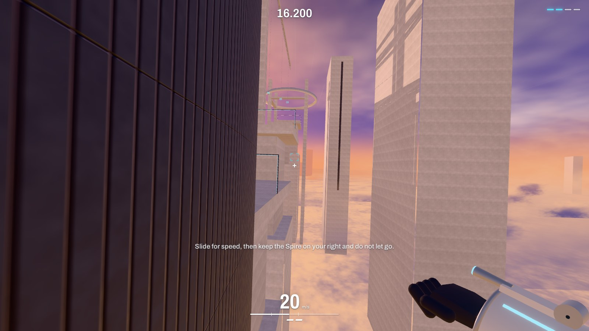
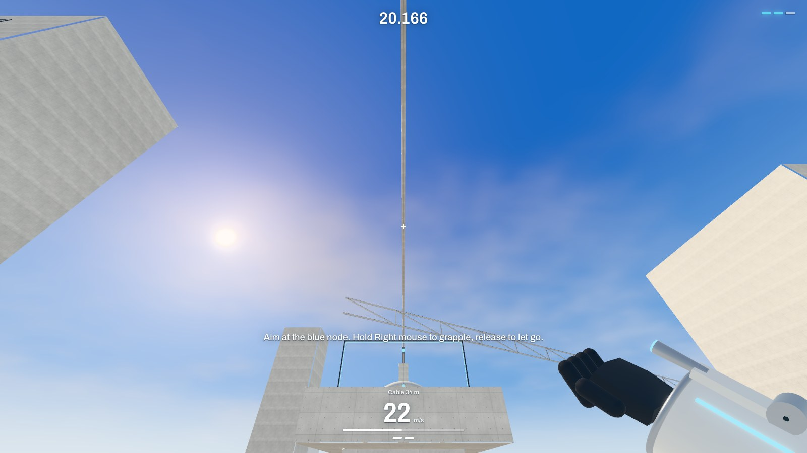
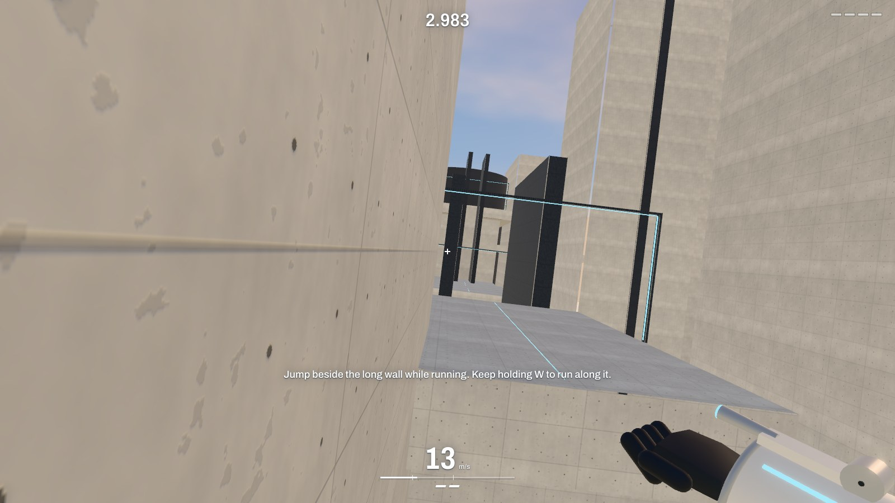
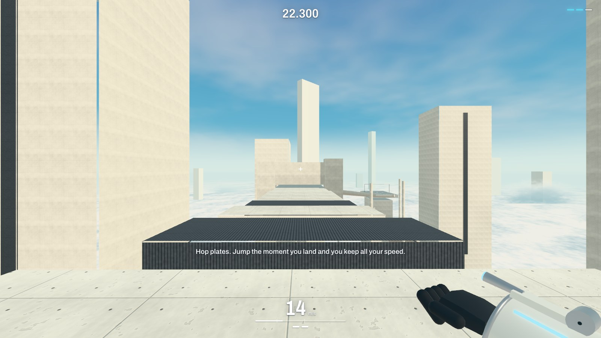
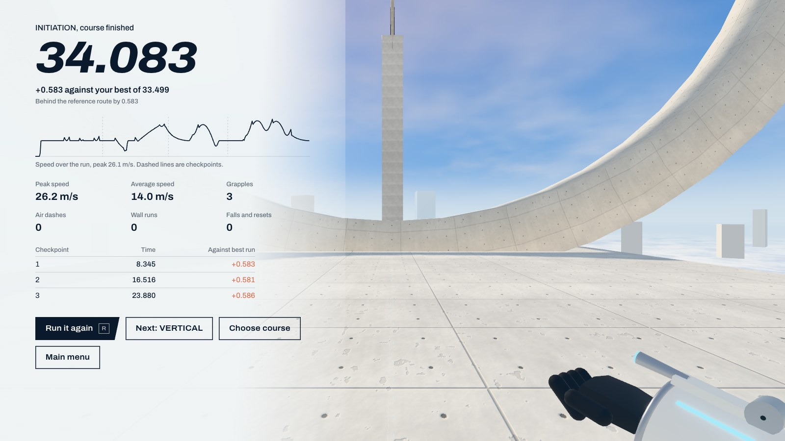

# STRYDE

**Movement is everything.**

**[Play it in your browser](https://yoonmax.github.io/stryde/)** (desktop, keyboard and mouse)

STRYDE is a first-person parkour and grappling game for the browser. Run, slide, wall-run, hop and swing
through five courses set in enormous concrete structures above the clouds, then come back and do it
faster against your own ghost. There is no combat. The only opponent is your last run.



| | |
|---|---|
|  |  |
|  |  |

All screenshots are captured from the running game by `scripts/capture-screenshots.mjs`. The action shots
and results are from whole runs played through the real game loop, not posed.

## Run it

Requires Node 20 or newer.

```bash
npm install
npm run dev
```

Build for production:

```bash
npm run build
npm run preview
```

`dist/` is a static site with no server component and uses relative paths, so any static host works, at any
sub-path. The live demo is deployed to GitHub Pages by `.github/workflows/deploy.yml` on every push to `main`,
after the unit tests pass. To host it elsewhere, use build command `npm run build` and output directory `dist`.

## Controls

| Action | Default |
|---|---|
| Move | W A S D |
| Look | Mouse |
| Jump, wall jump, wall kick | Space |
| Slide | C or Left Ctrl |
| Grapple | Hold right mouse |
| Reel in, reel out | Left mouse, F |
| Air dash | Q |
| Sprint | Shift (sprinting is always on by default, see Settings) |
| Restart course | R |
| Back to checkpoint | T |
| Course information | Hold Tab |
| Pause | Escape |

Every key can be rebound, with conflict handling. On Windows and Linux, Ctrl+W closes a browser tab and no
page can stop that outside fullscreen, so C is the default slide key and Settings offers fullscreen with
keyboard lock.

## What's in the game

- **Five courses**, each with its own light and landmark:
  **Initiation** (morning, the Halo) teaches run, jump, slide and swing.
  **Vertical** (golden hour, the Tuning Fork) is walls: chains, a chimney climbed by kicking, a run around a drum.
  **Pendulum** (noon, the Orrery) is release timing, reeling and a moving anchor.
  **Flow** (afternoon, the Ribbon) is one continuous line of slide, wall, swing, hop plates and dash.
  **Ascent** (dusk, the Spire) uses everything, with two sections that have real route choices.
- **The Commons**, a free-run playground: a swing hall, a wall garden, a slope bowl, a hop line and a skill line, with a teleport to each.
- **Time trials** with splits, personal bests and a recorded ghost.
- **Statistics** built only from your own gameplay.
- A full **settings** screen: mouse (with cm/360), rebinding, camera comfort, graphics presets and individual
  options, four volume buses, crosshair editor, movement assists.

The surfaces tell you what they do. White concrete can be wall-run. Dark ribbed cladding can be wall-run and
grappled. Bare metal can be grappled. Glass can do neither. Blue nodes always work.

## How it is built

JavaScript and JSX only: Three.js, React, Rapier (`@dimforge/rapier3d-compat`), GSAP, Zustand, Tailwind,
Web Audio, Vite, Vitest and Playwright. No bitmap textures or audio files are shipped. Every surface texture
and every sound is generated in the browser at load.

```
src/
  config/      movement.js: every tuning value, with the reason for it
  physics/     Rapier world, narrow query layer, swept capsule controller
  player/      tick order, ground and air forces, state machine, input, camera
  abilities/   jump, slide, wall run, air dash, grapple
  core/        Simulation (headless), Game (wiring), loop, flow
  timing/      tick-based run timer, checkpoints, swept volume tests
  replay/      recorder, binary codec, interpolated player, ghost renderer
  levels/      LevelBuilder, architecture vocabulary, five courses, free run
  rendering/   materials, geometry batching, sky and clouds, viewmodel, cable, effects
  audio/       synthesised sound
  settings/    persisted settings with validation
  stats/       local progress
  ui/          React screens and HUD
tests/
  unit/        movement, abilities, levels, input, timing, replay, settings, stats
  routes/      a bot that plays every course through the real simulation
  e2e/         Playwright, with real pointer lock, on a real GPU
```

The simulation has no dependency on the DOM or on Three.js. `Simulation` runs in Node exactly as it runs in the
game, which is what makes the tests below possible.

### Fixed-step movement

The simulation runs at 120 ticks per second regardless of frame rate. The camera's position interpolates between
the last two ticks. Its orientation comes straight from the most recent mouse event, with no smoothing and no
interpolation, so aim response is never delayed. Decorative camera motion (lean, dip, bob, FOV) is render-only
and can never affect physics.

[docs/MOVEMENT.md](docs/MOVEMENT.md) documents the rules in detail, including exactly when momentum is preserved,
redirected, limited or lost, and which rule prevents which exploit.

### Grappling

The rope is a one-sided distance constraint. It exerts no force while slack, and it never pulls the player toward
the anchor unless they reel in. It is solved on position:

```
x' = x + v dt
if |x' - a| > L:
    x' = a + L (x' - a) / |x' - a|
    v  = (x' - x) / dt
```

The corrected displacement is a chord of the rope sphere, and that chord can't be longer than the step that
produced it, so a free swing cannot gain energy from the solver. Tests assert this over a long swing, and also
that it does not bleed more than a fifth of the swing's energy away. Releasing changes nothing about velocity, so
whatever tangential speed you built is what you keep. Reeling shortens `L`, the same projection does real work,
and the swing speeds up the way a skater does when pulling their arms in.

Physics attach on the same tick as the button press. The cable's extension animation runs afterward and only ever
catches up to what has already happened.

### Collision

The player is a capsule moved by swept collide-and-slide against Rapier's scene queries. Each bump sweeps to first
contact and removes only the velocity going into the surface. Because every move is a continuous sweep, speed can't
tunnel: a test fires the player at 300 m/s into a wall 5 cm thick. Creases between two planes are handled as in
Quake's slide move. Low obstacles and lips caught by the feet step up at full speed, because a capsule clipping an
edge at 20 m/s would otherwise turn a near-miss into a dead stop.

Collision shapes are authored separately from visuals: boxes, cylinders and convex hulls for the route, and a
great deal of decorative massing with no collision at all.

One measured limit is worth knowing. Rapier's shape casts lost accuracy against very large boxes, starting at around
1.5 km, so `LevelBuilder` refuses solids over 700 m.

### Proving the courses work

Nobody should have to take a level designer's word that a course can be finished. A route bot plays each one through
the real simulation using only player inputs: the same tick rate, the same physics, nothing injected. Its time is
stored as the course's reference time, and a test fails if that number drifts from what the route really produces.

| Course | Reference route | Checkpoints |
|---|---|---|
| Initiation | 33.50 s | 3 |
| Vertical | 33.41 s | 4 |
| Pendulum | 29.52 s | 3 |
| Flow | 54.81 s | 3 |
| Ascent | 43.28 s (46.71 s by the alternate routes) | 4 |

These are clean scripted runs, not targets for a human and not records. A good player should beat them. Ascent's
alternate routes get their own test, so the choices are known to be real.

The same recorded inputs are then played through the actual browser game loop. Runs finish within 2 ms of the
headless time at whatever frame rate the machine manages, which is the practical proof that rendering cannot
change the outcome of a run.

### Timing

Run time is counted in simulation ticks. The tick accumulator is driven by the monotonic `performance.now()`, and
ticks simply don't happen while paused, so pausing, losing focus and slow frames can't corrupt a time. The timer
starts on the first tick after the countdown. It stops at the fraction of a tick where the player's swept path enters
the finish volume, so resolution is finer than the 8.3 ms tick. Time spent paused does not count, and Tab does not
stop the clock.

### Replays

Ghosts are sampled transforms at 30 Hz, not recorded inputs, so an old ghost still plays back correctly after movement
tuning changes. Each sample stores position, yaw, pitch, state flags, grapple anchor and speed, delta-coded as
zig-zag varints in centimetres and about 0.09 degree steps. Replays over 512 KB are refused rather than risking the
storage quota. Playback is addressed by the current run's tick, so it stays in sync through pauses and restarts.

### Rendering

- **Materials:** board-formed concrete with seams, tie holes and pour variation; ribbed graphite; matte ceramic;
  brushed aluminium. UVs are in real metres, so a formwork seam is the same width on every wall.
- **Chamfers:** every box has a chamfer a few centimetres wide. It catches the sun and draws a hairline along each
  edge, and does a lot to remove the look of raw primitives.
- **Batching:** static geometry is merged per material per 90 m cell, so a course is about 100 to 200 draw calls and
  unseen cells cull together. Nodes and the far skyline are instanced.
- **Light:** cascaded shadow maps, a sky baked into a prefiltered environment map per course, and sun-aware fog.
  Ambient is baked from a paler sky than the one on screen, which keeps white concrete's shadows from turning
  saturated blue.
- **Post:** MSAA or FXAA, optional screen-space AO, and a very low bloom only sun and guidance lights reach.

## Performance

Measured with `npm run measure` on one machine: Apple M4 Pro, Chromium with Metal, 1920x1080, device pixel ratio 1.
Vsync and the browser's frame limiter were disabled to show throughput rather than the display's rate. Each row covers
six fixed views across all courses, three seconds each.

| Preset | Average fps across views | Average frame | Worst 1% frame |
|---|---|---|---|
| Performance | 672 to 711 | 1.4 to 1.5 ms | 2.9 to 3.1 ms |
| Balanced | 293 to 326 | 3.1 to 3.4 ms | 4.4 to 4.7 ms |
| High (default) | 280 to 308 | 3.2 to 3.6 ms | 4.5 to 4.8 ms |
| Ultra (adds screen-space AO) | 106 to 143 | 7.0 to 9.5 ms | 8.1 to 11.3 ms |

At 2560x1440, High measured 168 to 172 fps in the two views sampled.

These views are static camera positions with the simulation idle, so they measure rendering, not a full game frame.
They are not a promise about other hardware, and an integrated GPU or a high-DPI display will differ a lot. A simulation
tick cost 5 to 9 microseconds in Node (`scripts/measure-sim.mjs`), which is negligible next to rendering. The frame
cap offers 60, 120, 144, 165, 240, 360 or uncapped. "Uncapped" means the game adds no limit of its own, and
`requestAnimationFrame` still cannot exceed what the browser and display allow.

The production bundle is about 2.0 MB gzipped, most of it the inlined Rapier WASM.

## Testing

```bash
npm test
```

200 tests run in under a second: movement, every ability, exploit limits, collision edge cases, determinism, all
course routes, spawn safety on every level, timing, replay encoding, input and rebinding, settings and statistics.

```bash
npx playwright install chromium
npm run test:e2e
```

19 browser tests use a real pointer lock and a real GPU. They cover menus, pause and resume, focus loss, restart,
respawn, whole recorded runs, ghost rendering, persistence across reloads, and runtime graphics changes. The config
passes `--use-angle=metal` for Apple GPUs; drop that flag on other platforms.

**What this does and does not establish.** The bot proves courses can be finished, not that they are fun. Movement feel,
difficulty and comfort have only been tuned against measurements and captured frames. **No human has playtested this
yet**, and audio has only been verified to run without errors, not listened to. Those are the first things to
do with it.

## Known limitations

- Keyboard and mouse only. Touch devices get a notice, and there is no gamepad support.
- Tested end to end in Chromium only. The code uses standard APIs and falls back where raw input is unavailable,
  but Firefox and Safari have not been run.
- The ghost is a stylised figure, with no running animation.
- The rope breaks when geometry cuts it, rather than wrapping around corners.
- Personal bests and ghosts are stored in this browser only. There are no leaderboards.
- The optional level editor from the original plan was not built.
- The JavaScript is one chunk. Splitting off Rapier and Three.js would help first-load caching.

## Credits

Typeface: [Archivo](https://github.com/Omnibus-Type/Archivo) by Omnibus-Type, under the SIL Open Font License.
